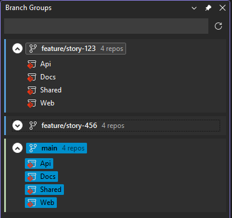

# BranchGrouper

Groups branches with identical names from multi-repo solutions.

## How to use

This extension on load scans the current solution, gets all loaded git repositories and extracts the known branches. It then groups up branches with identical names as "groups".
Active branches are marked with a blue background. If all repositories from a group are active, the group is also marked.

## Features

* Group Checkout
* Group Delete
* Pull Group
* Single Repo Checkout